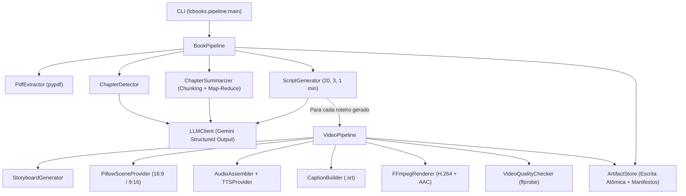
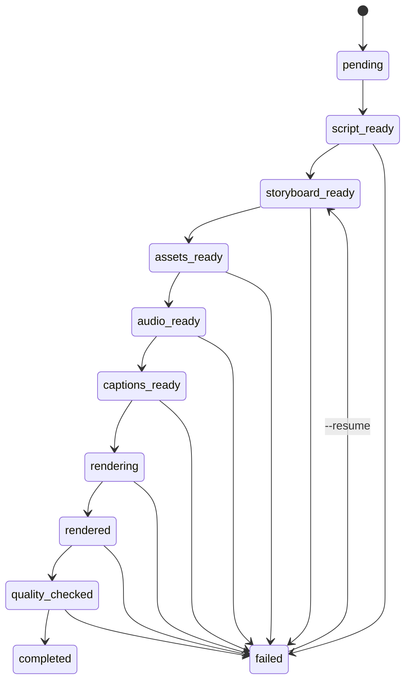

# lcBooks — Pipeline de Geração de Roteiros e Vídeos a partir de Livros em PDF

O **lcBooks** é um pipeline modular em Python que transforma livros em formato PDF (com camada de texto) em **mapas de capítulos validados**, **resumos acadêmicos rastreáveis às páginas da fonte**, **roteiros estruturados de 20, 3 e 1 minuto** e **vídeos MP4 completos** com cenas visuais, narração sintetizada (TTS) e legendas sincronizadas (`.srt`).

---

## Sumário

1. [Visão Geral e Princípios Arquiteturais](#1-visão-geral-e-princípios-arquiteturais)
2. [Arquitetura e Fluxo de Execução](#2-arquitetura-e-fluxo-de-execução)
3. [Estrutura do Repositório](#3-estrutura-do-repositório)
4. [Detalhamento Aprofundado do Código por Módulo](#4-detalhamento-aprofundado-do-código-por-módulo)
   - [4.1. Configuração e Variáveis de Ambiente (`config.py`)](#41-configuração-e-variáveis-de-ambiente-srclcbooksconfigpy)
   - [4.2. Hierarquia de Exceções por Estágio (`exceptions.py`)](#42-hierarquia-de-exceções-por-estágio-srclcbooksexceptionspy)
   - [4.3. Observabilidade e Sanitização de Logs (`logging_config.py`)](#43-observabilidade-e-sanitização-de-logs-srclcbookslogging_configpy)
   - [4.4. Contratos de Dados e Schemas Pydantic (`schemas/`)](#44-contratos-de-dados-e-schemas-pydantic-srclcbooksschemas)
   - [4.5. Extração de PDF e Detecção de Capítulos (`pdf/`)](#45-extração-de-pdf-e-detecção-de-capítulos-srclcbookspdf)
   - [4.6. Cliente LLM e Prompts Versionados (`llm/`)](#46-cliente-llm-e-prompts-versionados-srclcbooksllm)
   - [4.7. Serviços de Domínio e Orquestração (`services/`)](#47-serviços-de-domínio-e-orquestração-srclcbooksservices)
   - [4.8. Camada de Mídia: Cenas, TTS, Legendas, FFmpeg e Qualidade (`media/`)](#48-camada-de-mídia-cenas-tts-legendas-ffmpeg-e-qualidade-srclcbooksmedia)
   - [4.9. Armazenamento Atômico, Hashes e Manifestos (`storage/artifacts.py`)](#49-armazenamento-atômico-hashes-e-manifestos-srclcbooksstorageartifactspy)
   - [4.10. CLI e Camada de Retrocompatibilidade (`pipeline.py`)](#410-cli-e-camada-de-retrocompatibilidade-srclcbookspipelinepy)
5. [Estrutura do Diretório de Saída e Formato dos Artefatos](#5-estrutura-do-diretório-de-saída-e-formato-dos-artefatos)
6. [Instalação, Configuração e Execução](#6-instalação-configuração-e-execução)
7. [Suíte de Testes, Qualidade e CI](#7-suíte-de-testes-qualidade-e-ci)
8. [Segurança, Privacidade e Direitos Autorais](#8-segurança-privacidade-e-direitos-autorais)

---

## 1. Visão Geral e Princípios Arquiteturais

O projeto foi desenhado em torno de seis decisões técnicas fundamentais:

1. **Produção Incremental por Roteiro:** Assim que um roteiro (20, 3 ou 1 minuto) de um capítulo é gerado e salvo em disco, o `VideoPipeline` é acionado imediatamente para produzir o MP4 correspondente — sem aguardar o processamento de todos os capítulos do livro.
2. **Isolamento de Falhas:** Erros em um roteiro ou vídeo específico são capturados no escopo daquele artefato, registrados no manifesto com o estágio exato da falha (`failed_stage`) e não descartam roteiros ou vídeos já concluídos.
3. **Retomada Idempotente (`--resume`):** Cada artefato é acompanhado por hashes SHA-256 (`script_hash`, `config_hash`) e estados granulares no `manifest.json`. Caso a execução seja interrompida (por exemplo, no segmento 2 do TTS), relançar o comando reutiliza o resumo, o roteiro, o storyboard, as imagens e o segmento 1 do áudio já validados.
4. **Escrita Atômica:** Nenhum JSON, imagem, áudio, legenda ou vídeo é escrito diretamente no caminho final. Todos os arquivos são gravados com sufixo temporário (`.tmp`, `.partial.mp4`), verificados tecnicamente e promovidos ao nome definitivo via `Path.replace()` atômico.
5. **Desacoplamento de Providers via Protocolos:** Chamadas ao modelo Gemini (`LLMClient`), síntese de voz (`TTSProvider`) e criação de cenas (`SceneAssetProvider`) ficam atrás de interfaces explícitas. O sistema gera vídeos completos localmente com `PillowSceneProvider` e permite testes determinísticos sem custo usando `FakeTTSProvider`.
6. **Segurança e Privacidade por Padrão:** Chaves de API são ocultadas na serialização de configurações e filtradas por expressões regulares nos logs; o texto integral do livro nunca é despejado em logs de erro.

---

## 2. Arquitetura e Fluxo de Execução

### 2.1. Fluxo de Componentes



### 2.2. Máquina de Estados de Cada Vídeo (`VideoManifest.status`)

Cada roteiro possui seu próprio `manifest.json` dentro de `chapter_XX/video_YYmin/manifest.json`, transitando pelos seguintes estados:



---

## 3. Estrutura do Repositório

```text
lcBooks/
├── .env.example                           # Modelo de variáveis de ambiente
├── .gitignore                             # Regras de exclusão (segredos, PDFs, mídias, caches)
├── pyproject.toml                         # Metadados do pacote, dependências, entry point e Ruff/Pytest
├── requirements.txt                       # Espelho das dependências principais de execução
├── README.md                              # Documentação técnica abrangente do projeto
├── docs/
│   └── SDD.md                             # Software Design Document de referência
├── .github/
│   └── workflows/
│       └── ci.yml                         # Pipeline GitHub Actions (Python 3.11/3.12, FFmpeg, Ruff, Pytest)
├── src/
│   └── lcbooks/
│       ├── __init__.py
│       ├── config.py                      # Configurações tipadas via pydantic-settings
│       ├── exceptions.py                  # Exceções de domínio classificadas por estágio
│       ├── logging_config.py              # Logs estruturados em JSON e sanitização de segredos
│       ├── pipeline.py                    # Entry point CLI e funções de compatibilidade retroativa
│       ├── schemas/
│       │   ├── __init__.py
│       │   ├── chapters.py                # ChapterBoundary, ChapterMap, SupportedClaim, ChapterSummary, ChapterPackage
│       │   ├── script.py                  # NarrationSegment, VideoScript, ensure_script_segments()
│       │   └── video.py                   # StoryboardScene, QualityReport, VideoManifest, VideoStatus
│       ├── pdf/
│       │   ├── __init__.py
│       │   ├── extractor.py               # ExtractedPage, clean_text(), extract_pdf(), PdfExtractor
│       │   └── chapter_detector.py        # likely_chapter_pages(), page_samples(), validate_boundaries(), ChapterDetector
│       ├── llm/
│       │   ├── __init__.py
│       │   ├── prompts.py                 # PROMPT_VERSION, prompts de sistema e metas de palavras por duração
│       │   └── client.py                  # make_llm(), LLMClient com retry para falhas transitórias
│       ├── services/
│       │   ├── __init__.py
│       │   ├── summarizer.py              # ChapterSummarizer (chunking por página e consolidação)
│       │   ├── script_generator.py        # ScriptGenerator (validação de extensão e segmentação)
│       │   ├── storyboard.py              # StoryboardGenerator (mapeamento de falas para cenas)
│       │   ├── video_pipeline.py          # VideoPipeline (orquestração de um único vídeo)
│       │   └── book_pipeline.py           # BookPipeline (orquestração completa do livro)
│       ├── media/
│       │   ├── __init__.py
│       │   ├── captions.py                # TimedSpeechSegment, build_srt(), parse_srt_cues()
│       │   ├── ffmpeg_renderer.py         # RenderScene, RenderOptions, FFmpegRenderer
│       │   ├── quality.py                 # VideoQualityChecker (validação profunda via ffprobe)
│       │   ├── scenes/
│       │   │   ├── __init__.py
│       │   │   ├── base.py                # Protocolo SceneAssetProvider
│       │   │   └── pillow_provider.py     # PillowSceneProvider (geração local de cartões PNG)
│       │   └── tts/
│       │       ├── __init__.py
│       │       ├── base.py                # TTSProvider, FakeTTSProvider, measure_audio_duration(), AudioAssembler
│       │       └── google_cloud.py        # GoogleCloudTTS (Google Cloud Text-to-Speech API)
│       └── storage/
│           ├── __init__.py
│           └── artifacts.py               # Escrita atômica, SHA-256, ArtifactStore e manifestos
└── tests/
    ├── conftest.py                        # Gerador de PDFs sintéticos em memória/disco para testes
    ├── unit/
    │   ├── test_scripts.py                # Testes de schemas, config, sanitização, LLMClient, ScriptGenerator e Storyboard
    │   ├── test_pdf_extractor.py          # Testes de validação de PDF, limites e detecção de OCR
    │   ├── test_chapters.py               # Testes de detecção de capítulos, sobreposições e sumarizador em chunks
    │   ├── test_captions.py               # Testes de SRT (>1h, acentos, sobreposição) e AudioAssembler/TTS
    │   └── test_manifest.py               # Testes de FFmpegRenderer, VideoQualityChecker, falha parcial e --resume
    └── integration/
        └── test_video_pipeline.py         # Testes end-to-end (PDF -> MP4), caminhos com acentos/espaços, isolamento de falhas e CLI
```

---

## 4. Detalhamento Aprofundado do Código por Módulo

### 4.1. Configuração e Variáveis de Ambiente (`src/lcbooks/config.py`)

O módulo `config.py` centraliza a leitura e validação das variáveis de ambiente e do arquivo `.env` usando `pydantic-settings`:

- **`Settings(BaseSettings)`**:
  - **Credenciais e LLM:**
    - `gemini_api_key: str | None` e `google_api_key: str | None`: ambos declarados com `Field(default=None, repr=False)` para nunca aparecerem caso a instância de `Settings` seja impressa em logs ou tracebacks.
    - `gemini_model: str = "gemini-2.5-flash"`: modelo padrão do Gemini.
  - **Configurações de TTS:**
    - `tts_provider: Literal["google_cloud", "fake"] = "google_cloud"`: permite alternar entre a síntese real na nuvem e o gerador senoidal local (`fake`).
    - `tts_language: str = "pt-BR"`, `tts_voice: str = "pt-BR-Standard-A"`, `tts_speaking_rate: float = 1.0` (restrito ao intervalo `0.25..4.0`).
  - **Configurações de Vídeo e FFmpeg:**
    - `video_width: int = 1920` (`320..3840`), `video_height: int = 1080` (`320..3840`), `video_fps: int = 30` (`15..60`), `video_crf: int = 20` (`16..30`), `video_preset: str = "medium"`, `burn_captions: bool = True`, `lcbooks_font_path: str | None = None`.
  - **Limites Operacionais e Segurança:**
    - `max_pdf_mb: int = 100`, `max_pdf_pages: int = 1000`, `max_chapter_chars_per_chunk: int = 12000`, `max_retry_attempts: int = 3`.
  - **Método `safe_dict() -> dict[str, Any]`**: exporta o dicionário de configurações excluindo explicitamente `gemini_api_key` e `google_api_key`.
- **`get_settings() -> Settings`**: função decorada com `@lru_cache(maxsize=1)` que retorna um singleton validado da configuração.

---

### 4.2. Hierarquia de Exceções por Estágio (`src/lcbooks/exceptions.py`)

Todas as falhas operacionais herdam de `LCBooksError`, que carrega metadados usados pelo `ArtifactStore` para preencher `failed_stage` e `retryable` no `manifest.json`:

| Classe de Exceção | Valor de `stage` | Uso no Pipeline |
|---|---|---|
| `LCBooksError` | `"general"` | Classe base (`message`, `stage`, `retryable: bool`). |
| `PdfExtractionError` | `"pdf_extraction"` | Falha na extração de páginas de um PDF malformado. |
| `ChapterDetectionError` | `"chapter_detection"` | Capítulos sobrepostos, fora do intervalo de páginas ou mapa vazio em modo estrito. |
| `LLMServiceError` | `"llm"` | Ausência de `GEMINI_API_KEY` ou indisponibilidade persistente do provedor LLM. |
| `ScriptValidationError` | `"script_generation"` | Roteiro gerado fora dos contratos estruturais. |
| `StoryboardError` | `"storyboard"` | Falha na construção das cenas do storyboard. |
| `SceneGenerationError` | `"assets"` | Fonte TrueType inválida ou imagem gerada com dimensões incorretas. |
| `TTSServiceError` | `"audio"` | Erro de autenticação/chamada no TTS ou falha na concatenação de áudio. |
| `CaptionError` | `"captions"` | Erro na montagem das legendas `.srt`. |
| `VideoRenderError` | `"rendering"` | Falha no processo do FFmpeg durante a composição do MP4. |
| `VideoQualityError` | `"quality_check"` | MP4 final reprovado pelo `VideoQualityChecker` (sem áudio, resolução errada, SRT fora de faixa). |

---

### 4.3. Observabilidade e Sanitização de Logs (`src/lcbooks/logging_config.py`)

- **`sanitize_message(message: str, secrets: Iterable[str] = (), max_length: int = 2000) -> str`**:
  - Aplica a expressão regular `_API_KEY_PATTERN = re.compile(r"(AIza[0-9A-Za-z\-_]{16,}|ya29\.[0-9A-Za-z\-_]+)")` substituindo tokens Google/OAuth por `[REDACTED_KEY]`.
  - Substitui quaisquer segredos passados em `secrets` (com 4 ou mais caracteres) por `[REDACTED]`.
  - Trunca mensagens maiores que `max_length` adicionando `...[truncated]`.
- **`configure_logging(verbose: bool = False) -> logging.Logger`**:
  - Configura o logger `"lcbooks"` em nível `DEBUG` (quando `--verbose`) ou `INFO`.
- **`log_event(logger, event, *, job_id="", chapter_number=None, script_duration=None, stage="", level=logging.INFO, **extra)`**:
  - Emite uma linha JSON estruturada contendo `event`, `job_id`, `chapter_number`, `script_duration`, `stage` e campos adicionais sanitizados.

---

### 4.4. Contratos de Dados e Schemas Pydantic (`src/lcbooks/schemas/`)

#### 4.4.1. `src/lcbooks/schemas/chapters.py`
- **`ChapterBoundary`**: representa os limites de um capítulo (`number: int`, `title: str`, `start_page: int`, `end_page: int`, `evidence: str`).
- **`ChapterMap`**: lista de `chapters: list[ChapterBoundary]`, `notes: str` e `warnings: list[str]` (avisos de validação de intervalos).
- **`SupportedClaim`**: alegação rastreável ao texto original (`claim: str`, `source_pages: list[int]`, `confidence: Literal["high", "medium", "low"]`).
- **`ChapterSummary`**: resumo analítico do capítulo.
  - Possui o validador `@model_validator(mode="before") _normalize_claims`, que garante **dupla compatibilidade**:
    - Aceita objetos `SupportedClaim` (ou dicionários `{"claim": ..., "source_pages": [...]}`) nos campos `key_points`, `examples`, `quotes_or_definitions` e `definitions`, extraindo automaticamente as strings para `key_points`/`examples` e consolidando as alegações estruturadas em `supported_claims` e as páginas em `source_pages`.
    - Aceita o formato legado (`list[str]`) para leitura transparente de arquivos JSON gerados em versões anteriores.
- **`ChapterPackage`**: pacote consolidado de um capítulo (`chapter_number`, `chapter_title`, `page_range`, `summary`, `scripts`, `image_ideas`).

#### 4.4.2. `src/lcbooks/schemas/script.py`
- **`NarrationSegment`**: unidade atômica de fala sincronizável (`id: str`, ex.: `"seg_0001"`, `text: str` não vazio, `scene_hint: str`, `on_screen_text: str`, `source_pages: list[int]`).
- **`VideoScript`**: roteiro completo contendo `title`, `duration_minutes` (validado por `@field_validator("duration_minutes")` para permitir exclusivamente `1`, `3` ou `20`), `target_audience`, `hook`, `beats` (`min_length=1`), `narration` (`min_length=1`), `segments: list[NarrationSegment]`, `cta` e `b_roll_and_visuals`.
- **`ensure_script_segments(script: VideoScript, source_pages: list[int] | None = None) -> VideoScript`**:
  - Se o roteiro já possuir `segments`, normaliza seus IDs (`seg_0001`, `seg_0002`...) e propaga `source_pages` quando ausentes.
  - Se `segments` estiver vazio (roteiro legado ou retorno parcial do LLM), divide `script.narration` por blocos de parágrafos (`\n\s*\n+`), associa ciclicamente `script.beats` a `on_screen_text` e `script.b_roll_and_visuals` a `scene_hint`, retornando uma cópia normalizada do `VideoScript`.

#### 4.4.3. `src/lcbooks/schemas/video.py`
- **`StoryboardScene`**: associa uma cena visual (`scene_id`, ex.: `"scene_001"`) a um ou mais segmentos de fala (`segment_ids: list[str]`, `min_length=1`), definindo `visual_type` (`"title"`, `"image"`, `"diagram"`, `"quote"`, `"chapter_card"`), `visual_prompt`, `on_screen_text`, `asset_path`, `duration_seconds` (`> 0`) e `source_pages`.
- **`QualityReport`**: resultado da auditoria técnica do vídeo (`passed: bool`, `video_codec`, `audio_codec`, `width`, `height`, `fps`, `duration_seconds`, `has_audio`, `captions_present`, `warnings`, `errors`).
- **`VideoManifest`**: estado persistente de execução de um vídeo, armazenando caminhos relativos (`script_path`, `storyboard_path`, `narration_path`, `captions_path`, `video_path`, `quality_report_path`), métricas (`duration_seconds`, `width`, `height`, `attempts`), diagnóstico de erro (`failed_stage`, `error_message`, `retryable`) e hashes de invalidação (`script_hash`, `config_hash`, `prompt_version`).

---

### 4.5. Extração de PDF e Detecção de Capítulos (`src/lcbooks/pdf/`)

#### 4.5.1. `src/lcbooks/pdf/extractor.py`
- **`ExtractedPage`**: dataclass imutável (`frozen=True`) com `page_number: int`, `text: str` e `char_count: int`.
- **`clean_text(text: str) -> str`**: substitui bytes nulos (`\x00`) por espaço, colapsa espaços/tabs repetidos e reduz 3+ quebras de linha consecutivas para no máximo `\n\n`.
- **`extract_pdf(path: Path, *, max_bytes: int, max_pages: int) -> list[ExtractedPage]`**:
  1. Verifica existência e se `path.is_file()`.
  2. Compara `path.stat().st_size` com `max_bytes`.
  3. Lê os primeiros 5 bytes do arquivo e exige a assinatura binária `b"%PDF-"`.
  4. Abre o `PdfReader(str(path), strict=False)`, rejeitando PDFs protegidos por senha (`reader.is_encrypted`) ou que excedam `max_pages`.
  5. Extrai e limpa o texto de cada página (numeradas a partir de `1`).
  6. Se todas as páginas tiverem `char_count == 0`, levanta `ValueError("Nenhum texto extraído. O documento pode precisar de OCR.")`.
- **`PdfExtractor`**: classe de serviço que encapsula `extract_pdf` e fornece `get_range(pages, start, end) -> str`, formatando o intervalo com cabeçalhos `[Página i]`.

#### 4.5.2. `src/lcbooks/pdf/chapter_detector.py`
- **`likely_chapter_pages(pages) -> list[int]`**: inspeciona as primeiras 18 linhas de cada página buscando padrões de abertura de capítulo (`Capítulo N`, `Chapter X`, `Parte IV`, `1. Título...`) via regex.
- **`page_samples(pages, candidate_pages) -> str`**: constrói uma janela de contexto incluindo cada página candidata e suas vizinhas imediatas (`p - 1`, `p`, `p + 1`), limitando cada trecho a 1.800 caracteres com marcadores `--- PÁGINA p ---`.
- **`validate_boundaries(chapters, total_pages, *, strict=False) -> list[str]`**:
  - Verifica se `1 <= start_page <= end_page <= total_pages`.
  - Detecta títulos duplicados.
  - Detecta **sobreposições** (`ch.end_page >= nxt.start_page`) e **lacunas** (`nxt.start_page - ch.end_page > 1`).
  - Se `strict=True`, lança `ChapterDetectionError` imediatamente ao encontrar páginas fora do intervalo ou sobreposição; se `strict=False`, acumula os avisos em `mapping.warnings`.
- **`normalize_boundaries(mapping, total_pages, expected, *, strict=False) -> list[ChapterBoundary]`**: ordena os capítulos por `start_page`, registra os avisos de `validate_boundaries` em `mapping.warnings` e ajusta os limites para garantir partição contínua e válida dentro de `1..total_pages`.
- **`ChapterDetector`**: coordena `likely_chapter_pages`, `page_samples`, chamada estruturada ao `LLMClient` com `ChapterMap` e validação via `normalize_boundaries`.

---

### 4.6. Cliente LLM e Prompts Versionados (`src/lcbooks/llm/`)

#### 4.6.1. `src/lcbooks/llm/prompts.py`
- Define `PROMPT_VERSION = "v1.0.0"` (gravado nos manifestos para rastrear sob qual versão de engenharia de prompt cada artefato foi gerado).
- Centraliza os prompts de sistema em português do Brasil (`CHAPTER_DETECTION_SYSTEM_PROMPT`, `SUMMARY_SYSTEM_PROMPT`, `SCRIPT_SYSTEM_PROMPT`, `IMAGE_IDEAS_SYSTEM_PROMPT`).
- Define `DURATION_WORD_TARGETS`:
  - **1 minuto:** `110` a `170` palavras.
  - **3 minutos:** `330` a `480` palavras.
  - **20 minutos:** `2.200` a `3.100` palavras.

#### 4.6.2. `src/lcbooks/llm/client.py`
- **`make_llm(model, temperature=0.2, api_key=None)`**: instancia `ChatGoogleGenerativeAI` com `BLOCK_NONE` nas categorias de filtro de segurança para permitir análise literária de obras de suspense/drama ficcional sem falsos positivos.
- **`LLMClient`**:
  - Inicializa o modelo de forma preguiçosa (`lazy`) na propriedade `raw_llm` ou aceita uma instância injetada (`raw_llm=...`) para testes.
  - **`generate_structured(*, system_prompt, user_prompt, schema)`**:
    - Invoca `raw_llm.with_structured_output(schema)`.
    - Se ocorrer `ValidationError` do Pydantic (erro determinístico de schema), registra o aviso sanitizado e **não** repete a chamada.
    - Se ocorrer exceção transitória (timeout, limite de taxa, erro de rede), realiza até `max_retries` novas tentativas com espera progressiva (`retry_delay_seconds * attempt`).

---

### 4.7. Serviços de Domínio e Orquestração (`src/lcbooks/services/`)

#### 4.7.1. `src/lcbooks/services/summarizer.py` (`ChapterSummarizer`)
- Resolve o problema de capítulos extensos que extrapolariam a janela de contexto ou degradariam a qualidade do resumo:
  1. **`_split_into_chunks(text, max_chars)`**: divide o texto do capítulo respeitando quebras de parágrafo (`\n\n`) até o limite `max_chars_per_chunk` (padrão: `12.000` caracteres).
  2. **Etapa Map:** gera um `ChapterSummary` parcial para cada bloco.
  3. **Higienização de Páginas (`_sanitize_summary_pages`)**: filtra todas as páginas citadas em `source_pages`, `supported_claims` e `definitions`, mantendo **apenas** números de página que realmente pertencem ao intervalo `[boundary.start_page, boundary.end_page]`.
  4. **Etapa Reduce (Consolidação):** quando há múltiplos blocos, envia os JSONs dos resumos parciais ao LLM para sintetizar um `ChapterSummary` único do capítulo (com fallback de união sem duplicatas caso a consolidação falhe).

#### 4.7.2. `src/lcbooks/services/script_generator.py` (`ScriptGenerator`)
- **`generate(summary, boundary, duration_minutes=3) -> VideoScript`**:
  1. Consulta a faixa de palavras alvo em `DURATION_WORD_TARGETS[duration_minutes]`.
  2. Solicita ao `LLMClient` um `VideoScript` estruturado.
  3. **Validação de Extensão (`_is_within_word_tolerance`)**: conta as palavras de `result.narration`. Se a contagem estiver fora da tolerância (`< 70%` do mínimo ou `> 135%` do máximo), dispara **uma regeneração direcionada** informando ao modelo a contagem obtida e a faixa esperada.
  4. Normaliza os segmentos de fala com `ensure_script_segments(result, source_pages=...)`.
- **`generate_image_ideas(summary, boundary) -> list[str]`**: gera as 10 sugestões visuais descritivas para o pacote do capítulo.

#### 4.7.3. `src/lcbooks/services/storyboard.py` (`StoryboardGenerator`)
- Transforma cada `NarrationSegment` do roteiro em uma `StoryboardScene`:
  - Seleciona automaticamente o `visual_type`:
    - 1ª cena: `"chapter_card"` com `"Capítulo N: Título"`.
    - Última cena (quando há mais de 2 cenas): `"title"`.
    - Segmentos contendo aspas (`"` ou `'`): `"quote"`.
    - Demais segmentos: `"image"`.
  - Calcula a duração inicial estimada a partir do número de palavras do segmento (`words / words_per_minute * 60`), que será posteriormente substituída pela duração exata medida do arquivo de áudio TTS.

#### 4.7.4. `src/lcbooks/services/video_pipeline.py` (`VideoPipeline`)
Coordena as 6 etapas de construção de um vídeo para um único roteiro:
1. **Inicialização/Retomada do Manifesto:** calcula `script_hash = sha256(script.narration)` e `config_hash = sha256(width, height, fps, burn_captions, aspect_ratio)`. Se `resume=True`, os hashes coincidirem, `manifest.status == "completed"` e `video.mp4` existir (> 1 KB), retorna imediatamente o vídeo pronto.
2. **Storyboard (`storyboard_ready`):** carrega `storyboard.json` existente (em modo `resume`) ou gera novas cenas com `StoryboardGenerator`.
3. **Ativos Visuais (`assets_ready`):** ajusta dimensões conforme `--aspect-ratio` (`16:9` -> `1920x1080` ou `9:16` -> `1080x1920`) e gera `scenes/scene_001.png`... via `SceneAssetProvider`, reutilizando PNGs válidos em caso de retomada.
4. **Síntese e Montagem de Áudio (`audio_ready`):** chama `AudioAssembler.synthesize_script_segments`, que gera `audio/segment_001.mp3`..., mede a duração real de cada segmento com `ffprobe` e concatena tudo em `audio/narration.mp3`. Em seguida, **atualiza `duration_seconds` de cada cena no `storyboard.json`** para refletir exatamente a duração medida do respectivo segmento de voz.
5. **Legendas Sincronizadas (`captions_ready`):** gera `captions.srt` a partir dos intervalos reais `TimedSpeechSegment`.
6. **Renderização (`rendering` -> `rendered`) e Auditoria (`quality_checked` -> `completed`):** executa `FFmpegRenderer.render` e valida o MP4 resultante com `VideoQualityChecker.check`, salvando `quality_report.json` e marcando o manifesto como `completed`. Qualquer exceção em qualquer etapa aciona `store.mark_failed(manifest, stage=current_stage, error=exc)`.

#### 4.7.5. `src/lcbooks/services/book_pipeline.py` (`BookPipeline`)
Orquestrador de alto nível do livro:
- **`BookPipeline.from_environment(...)`**: fábrica que constrói toda a árvore de dependências a partir de `Settings`.
- **`run(...) -> RunResult`**:
  1. Extrai o PDF e grava `book.json`.
  2. Detecta os capítulos e grava `mapa_capitulos.json`.
  3. Para cada capítulo:
     - Carrega ou gera `summary.json` (e `chapter.json`).
     - Para cada duração solicitada em `durations` (ex.: `[20, 3, 1]`):
       - Carrega ou gera `script_XXmin.json`.
       - Se `render_videos=True`, chama **imediatamente** `video_pipeline.render(...)`.
       - Se ocorrer falha e `continue_on_error=True`, registra a falha em `manifest.json` e `failed_artifacts` e avança para a próxima duração/capítulo.
     - Salva `capitulo_XX.json`.
  4. Ao final, grava `resultado_completo.json`, `roteiros_e_ideias.md`, `manifest.json` global e `run_report.json`.

---

### 4.8. Camada de Mídia: Cenas, TTS, Legendas, FFmpeg e Qualidade (`src/lcbooks/media/`)

#### 4.8.1. Geração de Cenas (`media/scenes/base.py` e `pillow_provider.py`)
- **`PillowSceneProvider`**:
  - Renderiza cartões visuais em RGB na resolução exata configurada (`1920x1080` para `16:9` ou `1080x1920` para `9:16`).
  - Desenha fundo azul-noturno `(18, 25, 48)`, elipse decorativa de profundidade, moldura arredondada `(25, 36, 65)` com borda `(85, 120, 165)`, selo do tipo visual (`CHAPTER_CARD`, `IMAGE`, `QUOTE`, `TITLE`), texto principal quebrado automaticamente (24 colunas em retrato, 32 em paisagem) e rodapé com identificação `LCBOOKS • Pág. X-Y`.
  - Salva em `.tmp.png`, abre a imagem gerada com `Image.open()` para confirmar integridade e dimensões exatas e faz `replace()` para o caminho final.

#### 4.8.2. Síntese de Voz e Montagem de Áudio (`media/tts/base.py` e `google_cloud.py`)
- **`FakeTTSProvider`**:
  - Calcula a duração proporcional às palavras do segmento (`max(0.6, words * seconds_per_word)`).
  - Sintetiza matematicamente uma onda senoidal de 440 Hz em PCM 16-bit mono a 24.000 Hz (`_write_sine_wav`) e, quando o FFmpeg está disponível, converte para `.mp3` (`128k`).
- **`GoogleCloudTTS`**:
  - Integra com `google.cloud.texttospeech.TextToSpeechClient`.
  - Rejeita textos vazios antes de realizar chamadas de rede, respeita o limite de bytes da API e grava o conteúdo MP3 de forma atômica (`.tmp.mp3` -> `.mp3`).
- **`measure_audio_duration(audio_path: Path) -> float`**:
  - Inspeciona a duração exata do arquivo via `ffprobe -show_entries format=duration -of json`, com fallback para leitura de frames via módulo nativo `wave`.
- **`AudioAssembler`**:
  - Sintetiza cada `NarrationSegment` em `audio/segment_001.mp3`, `segment_002.mp3`...
  - Em modo `resume=True`, se `segment_XXX.mp3` já existir e não estiver vazio, reutiliza o arquivo sem chamar o TTS novamente.
  - Concatena todos os segmentos usando o filtro `concat=n=N:v=0:a=1[aout]` do FFmpeg para produzir `audio/narration.mp3` normalizado em 24 kHz mono (`192k`).

#### 4.8.3. Legendas Sincronizadas (`media/captions.py`)
- **`build_srt(segments: list[TimedSpeechSegment], output_path: Path) -> Path`**:
  - Sanitiza bytes nulos e espaços excedentes.
  - Garante **monotonicidade estrita**: `start = max(last_end, segment.start_seconds, 0.0)`, impedindo qualquer sobreposição entre blocos consecutivos.
  - Quebra falas longas em blocos curtos (`_caption_chunks`: máximo de 8 palavras ou 42 caracteres por cue) e distribui o tempo `[start, end]` do segmento proporcionalmente à quantidade de palavras de cada bloco.
  - Formata timestamps no padrão `HH:MM:SS,mmm` (`_srt_time`) suportando vídeos com mais de 1 hora e grava atomicamente em UTF-8.
- **`parse_srt_cues(srt_path: Path)`**: lê e valida todos os blocos `(numero, inicio_seg, fim_seg, texto)` de um arquivo `.srt`.

#### 4.8.4. Renderizador de Vídeo (`media/ffmpeg_renderer.py`)
- **`require_binary(name: str, *, allow_venv_fallback: bool = True) -> str`**:
  - Localiza `ffmpeg` e `ffprobe` no `PATH` do sistema ou no diretório `.venv/bin` do ambiente virtual ativo, lançando `RuntimeError` com mensagem clara de instalação caso ausentes.
- **`FFmpegRenderer.render(scenes, narration_path, output_path, captions_path=None) -> Path`**:
  - Valida a existência de todas as imagens de cena, do arquivo `narration.mp3` e do `captions.srt` (quando `burn_captions=True`).
  - Copia temporariamente `captions.srt` para um `tempfile.TemporaryDirectory` seguro antes de passá-lo ao filtro `subtitles=filename='...'`, garantindo que caminhos de saída com espaços, acentos, dois-pontos ou caracteres especiais nunca quebrem o parser de filtros do FFmpeg.
  - Monta o `filter_complex` para cada cena `i`:
    ```text
    [i:v]scale=W:H:force_original_aspect_ratio=increase,crop=W:H,setsar=1,fps=FPS,trim=duration=D,setpts=PTS-STARTPTS,format=yuv420p[vi]
    ```
  - Concatena todos os fluxos de vídeo (`concat=n=N:v=1:a=0[vconcat]`), aplica `subtitles` quando habilitado e codifica em **H.264 (`libx264`) + AAC (`192k`) + `yuv420p` + `-movflags +faststart`** em um arquivo temporário `video.partial.mp4`.
  - Executa uma verificação preliminar com `ffprobe` garantindo que `video.partial.mp4` possui streams `video` e `audio` e duração positiva antes de renomeá-lo para `video.mp4`. Em caso de qualquer erro, `video.partial.mp4` é removido no bloco `except`.

#### 4.8.5. Verificador de Qualidade (`media/quality.py`)
- **`VideoQualityChecker.check(video_path, *, expected_audio_duration=None, captions_path=None, raise_on_failure=True) -> QualityReport`**:
  - Inspeciona `video.mp4` com `ffprobe` e verifica:
    1. Existência e tamanho mínimo em bytes (`>= 1024`).
    2. Presença obrigatória de stream de vídeo e stream de áudio (`has_audio == True`).
    3. Resolução exata (`width == expected_width` e `height == expected_height`).
    4. Duração positiva e compatível com a duração do áudio (`expected_audio_duration`).
    5. Existência do arquivo `.srt` e garantia de que o último timestamp da legenda não ultrapassa a duração do vídeo/áudio.
  - Se qualquer verificação obrigatória falhar e `raise_on_failure=True`, lança `VideoQualityError`.

---

### 4.9. Armazenamento Atômico, Hashes e Manifestos (`src/lcbooks/storage/artifacts.py`)

- **`atomic_write_text` e `atomic_write_json`**: gravam primeiro em `.{nome}.tmp` no mesmo diretório (mesmo filesystem) e executam `tmp_path.replace(path)` para garantir que leitores nunca encontrem arquivos truncados.
- **`ArtifactStore`**:
  - Converte todos os caminhos persistidos em manifestos para **caminhos relativos POSIX** em relação ao diretório de saída (`relative_str`), evitando vazar caminhos absolutos da máquina local.
  - Gerencia a leitura/escrita de `book.json`, `mapa_capitulos.json`, `chapter.json`, `summary.json`, `script_XXmin.json`, `storyboard.json`, `quality_report.json`, `manifest.json` (por vídeo e consolidado na raiz), `capitulo_XX.json`, `resultado_completo.json` e `roteiros_e_ideias.md`.

---

### 4.10. CLI e Camada de Retrocompatibilidade (`src/lcbooks/pipeline.py`)

O módulo `src/lcbooks/pipeline.py` preserva todas as funções públicas originais (`clean_text`, `read_pdf`, `likely_chapter_pages`, `page_samples`, `chapter_text`, `make_llm`, `invoke_structured`, `normalize_boundaries`, `generate_package`, `write_markdown`) delegando para os novos serviços modulares, além de definir o parser CLI (`build_parser`) e a função `main()`.

---

## 5. Estrutura do Diretório de Saída e Formato dos Artefatos

Ao executar o pipeline com `--render-videos`, a estrutura gerada no diretório `--output` é:

```text
saida_livro/
├── book.json                      # Metadados do PDF (nome, SHA-256, páginas, prompt_version)
├── mapa_capitulos.json            # Capítulos detectados, notas e avisos de validação
├── manifest.json                  # Manifesto global consolidado (todos os vídeos e falhas)
├── run_report.json                # Métricas da execução (tempo total, capítulos, vídeos, falhas)
├── resultado_completo.json        # Lista consolidada de ChapterPackage (compatível com v0.1)
├── roteiros_e_ideias.md           # Documento Markdown consolidado de leitura humana
├── capitulo_01.json               # Pacote completo do Capítulo 1 (compatível com v0.1)
└── chapter_01/
    ├── chapter.json               # Limites do capítulo (ChapterBoundary)
    ├── summary.json               # Resumo rastreável (ChapterSummary)
    ├── script_20min.json          # Roteiro de 20 min com segmentos (VideoScript)
    ├── script_03min.json          # Roteiro de 3 min com segmentos (VideoScript)
    ├── script_01min.json          # Roteiro de 1 min com segmentos (VideoScript)
    ├── video_20min/...
    ├── video_03min/
    │   ├── manifest.json          # Estado e hashes deste vídeo (VideoManifest)
    │   ├── storyboard.json        # Cenas vinculadas aos segmentos e durações reais
    │   ├── scenes/
    │   │   ├── scene_001.png      # Cartão de abertura do capítulo
    │   │   ├── scene_002.png      # Cena de desenvolvimento
    │   │   └── scene_003.png      # Cartão de encerramento / CTA
    │   ├── audio/
    │   │   ├── segment_001.mp3    # Áudio TTS individual do segmento 1
    │   │   ├── segment_002.mp3    # Áudio TTS individual do segmento 2
    │   │   ├── segment_003.mp3    # Áudio TTS individual do segmento 3
    │   │   └── narration.mp3      # Narração completa concatenada
    │   ├── captions.srt           # Legendas sincronizadas em formato SubRip
    │   ├── video.mp4              # Vídeo final H.264 + AAC validado
    │   └── quality_report.json    # Relatório técnico do ffprobe (QualityReport)
    └── video_01min/...
```

### Exemplo de `chapter_01/video_03min/manifest.json`

```json
{
  "job_id": "job_a1b2c3d4",
  "chapter_number": 1,
  "script_duration_minutes": 3,
  "status": "completed",
  "script_path": "chapter_01/script_03min.json",
  "storyboard_path": "chapter_01/video_03min/storyboard.json",
  "narration_path": "chapter_01/video_03min/audio/narration.mp3",
  "captions_path": "chapter_01/video_03min/captions.srt",
  "video_path": "chapter_01/video_03min/video.mp4",
  "quality_report_path": "chapter_01/video_03min/quality_report.json",
  "duration_seconds": 178.42,
  "width": 1920,
  "height": 1080,
  "attempts": 1,
  "failed_stage": null,
  "error_message": null,
  "retryable": false,
  "script_hash": "e3b0c44298fc1c149afbf4c8996fb92427ae41e4649b934ca495991b7852b855",
  "config_hash": "6b86b273ff34fce19d6b804eff5a3f5747ada4eaa22f1d49c01e52ddb7875b4b",
  "prompt_version": "v1.0.0"
}
```

---

## 6. Instalação, Configuração e Execução

### 6.1. Pré-requisitos

- **Python 3.9+** (recomendado Python 3.11 ou 3.12).
- **FFmpeg e ffprobe** instalados e disponíveis no `PATH` (necessários quando `--render-videos` é utilizado):
  - **macOS (Homebrew):** `brew install ffmpeg`
  - **Ubuntu / Debian:** `sudo apt-get update && sudo apt-get install -y ffmpeg`

### 6.2. Instalação do Ambiente Virtual

```bash
python3 -m venv .venv
source .venv/bin/activate
pip install -e ".[dev]"
cp .env.example .env
```

### 6.3. Referência Completa de Variáveis de Ambiente (`.env`)

| Variável | Padrão | Descrição |
|---|---|---|
| `GEMINI_API_KEY` | `None` | Chave da API Google Gemini (obrigatória para chamadas reais ao LLM). |
| `GOOGLE_API_KEY` | `None` | Alternativa aceita caso `GEMINI_API_KEY` não esteja definida. |
| `GEMINI_MODEL` | `gemini-2.5-flash` | Nome do modelo Gemini utilizado nas extrações estruturadas. |
| `TTS_PROVIDER` | `google_cloud` | Provider de voz: `google_cloud` (produção) ou `fake` (áudio local para testes). |
| `TTS_LANGUAGE` | `pt-BR` | Código de idioma BCP-47 para síntese de voz. |
| `TTS_VOICE` | `pt-BR-Standard-A` | Nome da voz no Google Cloud Text-to-Speech. |
| `TTS_SPEAKING_RATE` | `1.0` | Velocidade da fala (`0.25` a `4.0`). |
| `VIDEO_WIDTH` | `1920` | Largura base do vídeo em pixels (`320` a `3840`). |
| `VIDEO_HEIGHT` | `1080` | Altura base do vídeo em pixels (`320` a `3840`). |
| `VIDEO_FPS` | `30` | Taxa de quadros por segundo (`15` a `60`). |
| `VIDEO_CRF` | `20` | Constant Rate Factor do H.264 (`16` = maior qualidade, `30` = menor arquivo). |
| `VIDEO_PRESET` | `medium` | Preset de velocidade/compressão do encoder `libx264` (`ultrafast` a `slow`). |
| `BURN_CAPTIONS` | `true` | Quando `true`, incorpora as legendas `.srt` diretamente nos quadros do vídeo. |
| `LCBOOKS_FONT_PATH` | `None` | Caminho opcional para um arquivo de fonte `.ttf` específico para os cartões Pillow. |
| `MAX_PDF_MB` | `100` | Tamanho máximo permitido para o arquivo PDF de entrada (em MB). |
| `MAX_PDF_PAGES` | `1000` | Número máximo de páginas permitido no PDF. |
| `MAX_CHAPTER_CHARS_PER_CHUNK` | `12000` | Limite de caracteres por bloco enviado ao sumarizador de capítulos. |
| `MAX_RETRY_ATTEMPTS` | `3` | Número máximo de retentativas automáticas para falhas transitórias na LLM. |

> **Nota sobre Google Cloud TTS:** A chave `GEMINI_API_KEY` autentica o Gemini, mas o serviço `GoogleCloudTTS` utiliza **Application Default Credentials (ADC)** do Google Cloud (`GOOGLE_APPLICATION_CREDENTIALS=/caminho/credencial.json` ou `gcloud auth application-default login`). Para testar a geração de vídeos localmente sem configurar credenciais GCP, defina `TTS_PROVIDER=fake` no `.env`.

### 6.4. Referência de Flags da CLI (`lcbooks`)

| Flag / Argumento | Padrão | Descrição |
|---|---|---|
| `pdf` | *(obrigatório)* | Caminho para o arquivo PDF de entrada. |
| `--output PATH` | `saida_livro` | Diretório onde os artefatos e vídeos serão gravados. |
| `--chapters INT` | `25` | Estimativa inicial do número de capítulos do livro. |
| `--model NOME` | `$GEMINI_MODEL` | Sobrescreve o modelo Gemini configurado no ambiente. |
| `--durations LISTA` | `20,3,1` | Lista de durações desejadas em minutos separadas por vírgula (valores aceitos: `1`, `3`, `20`). |
| `--aspect-ratio {16:9,9:16}` | `16:9` | Proporção do vídeo (`16:9` horizontal ou `9:16` vertical para Shorts/Reels/TikTok). |
| `--render-videos` / `--no-render-videos` | `--no-render-videos` | Habilita ou desabilita a renderização automática do MP4 após cada roteiro. |
| `--resume` / `--no-resume` | `--resume` | Reutiliza etapas e arquivos já concluídos e validados em execuções anteriores. |
| `--continue-on-error` / `--no-continue-on-error` | `--continue-on-error` | Continua processando os demais roteiros caso um artefato falhe isoladamente. |
| `--force` | `False` | Ignora caches anteriores e regenera todos os artefatos solicitados. |
| `--verbose` | `False` | Ativa logs estruturados detalhados em nível `DEBUG`. |

### 6.5. Exemplos de Comandos

**Modo 1 — Gerar apenas capítulos, resumos, roteiros e ideias visuais (sem vídeo):**
```bash
lcbooks ./meu_livro.pdf --output ./saida_livro --chapters 15
```

**Modo 2 — Fatia vertical rápida (1 capítulo, vídeo de 3 minutos em 16:9):**
```bash
lcbooks ./meu_livro.pdf \
  --output ./saida_teste \
  --chapters 1 \
  --durations 3 \
  --render-videos
```

**Modo 3 — Vídeo curto vertical (`9:16`) de 1 minuto para Reels/Shorts/TikTok:**
```bash
lcbooks ./meu_livro.pdf \
  --output ./saida_shorts \
  --chapters 5 \
  --durations 1 \
  --aspect-ratio 9:16 \
  --render-videos
```

**Modo 4 — Produção completa (20, 3 e 1 min) com retomada automática e tolerância a falhas:**
```bash
lcbooks ./meu_livro.pdf \
  --output ./saida_completa \
  --chapters 25 \
  --durations 20,3,1 \
  --aspect-ratio 16:9 \
  --render-videos \
  --resume \
  --continue-on-error
```

---

## 7. Suíte de Testes, Qualidade e CI

Os testes foram construídos para rodar integralmente **sem chamadas de rede e sem custos de API**, utilizando PDFs sintéticos gerados em tempo de execução (`tests/conftest.py`), `FakeLLM`, `FakeTTSProvider`, `PillowSceneProvider` e renderização real via `FFmpegRenderer` + `VideoQualityChecker`.

### Comandos de Verificação

```bash
# Executar toda a suíte de testes (unitários e integração)
.venv/bin/pytest

# Executar testes com relatório de cobertura por linha
.venv/bin/pytest --cov=lcbooks --cov-report=term-missing

# Verificar linting e formatação com Ruff
.venv/bin/ruff check src tests
.venv/bin/ruff format --check src tests
```

### Cobertura dos Casos de Teste

- **`tests/unit/test_scripts.py`**: validação de durações permitidas (`1, 3, 20`), rejeição de roteiros/cenas vazias, segmentação automática de narrações legadas, compatibilidade de `ChapterSummary` (`str` vs `SupportedClaim`), ocultação de chaves em `Settings`, redação de segredos em logs, retry transitório no `LLMClient`, regeneração por contagem de palavras no `ScriptGenerator` e geração de cartões PNG no `PillowSceneProvider`.
- **`tests/unit/test_pdf_extractor.py`**: rejeição de PDF inexistente, acima do tamanho máximo, sem cabeçalho `%PDF-`, acima do limite de páginas, PDF sem camada de texto (sugerindo OCR) e extração de intervalos `[Página i]`.
- **`tests/unit/test_chapters.py`**: heurísticas de páginas candidatas, detecção de capítulos sobrepostos e fora de intervalo (`ChapterDetectionError`), registro de avisos em `ChapterMap.warnings` e sumarização em múltiplos chunks com filtragem de páginas inválidas.
- **`tests/unit/test_captions.py`**: formatação de tempo SRT (incluindo `> 1 hora`), resolução monotônica de intervalos sobrepostos, preservação de acentuação UTF-8, remoção de bytes nulos, rejeição de texto vazio no TTS e montagem de áudio por segmentos no `AudioAssembler`.
- **`tests/unit/test_manifest.py`**: erro acionável quando `ffmpeg`/`ffprobe` estão ausentes, limpeza automática de `.partial.mp4` quando a renderização falha, reprovação de MP4 sem trilha de áudio pelo `VideoQualityChecker`, preservação do `segment_001.mp3` quando o `segment_002` falha no TTS e retomada idempotente com `--resume`.
- **`tests/integration/test_video_pipeline.py`**: pipeline completo de ponta a ponta (PDF -> capítulos -> resumo -> roteiros -> storyboard -> cenas Pillow -> áudio -> SRT queimado -> MP4 validado) em diretórios contendo espaços e acentuação (`Saída de Vídeo — Edição Áéíóú`), isolamento de falha no roteiro de 3 min preservando os vídeos de 20 min e 1 min, e testes de CLI/retrocompatibilidade.

---

## 8. Segurança, Privacidade e Direitos Autorais

1. **Segurança na Execução de Subprocessos:** Todas as chamadas ao `ffmpeg` e `ffprobe` utilizam `subprocess.run([...], shell=False)` com listas de argumentos tipados e diretórios temporários isolados para filtros de legenda.
2. **Proteção de Credenciais:** Nunca versione o arquivo `.env` nem credenciais JSON do Google Cloud. Os logs da aplicação passam por `sanitize_message()` antes de serem emitidos.
3. **Direitos Autorais:** Certifique-se de possuir autorização legal para processar o PDF de entrada e utilizar quaisquer ativos antes de gerar ou publicar vídeos. O sistema é voltado para síntese analítica, crítica literária e estudo, atribuindo sempre as páginas de referência da obra original.
